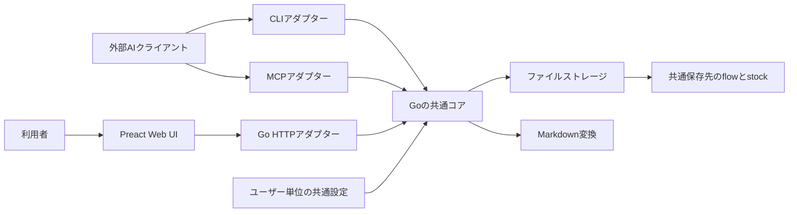

# fragmentの共通ドキュメントストアのデザインドック

| 項目 | 内容 |
| --- | --- |
| 状態 | Proposed |
| 更新日 | 2026年10月12日 |
| 対象 | 個人の端末で利用する初期版 |
| 設計レビュー | [PR 1](https://github.com/s4na/fragment/pull/1) |

## 概要

fragmentは、ユーザーのドキュメントフォルダにあるMarkdownをCLI、MCP、Web UIから共通して読み書きするローカルアプリケーションである。プロジェクトごとに `flow` と `stock` を持ち、本文とフォルダ構成は利用者とAIが自由に決める。Web UIは保存済みのMarkdownを整形して表示する。

初期版では、通常のMarkdownファイルを正本にし、Goの共通コアを各入口から直接利用する構成を提案する。保存先はユーザー単位の共通設定で決め、ghqのリポジトリ、ブランチ、worktreeから独立させる。複数の入口による書き込みは、保存先単位のプロセス間ロックと内容ハッシュによる競合検出で保護する。

以下の操作や保証は設計方針である。実装の完了条件は「検証計画と受け入れ条件」に示す。

## 背景とスコープ

利用者は、異なるリポジトリやブランチでAIと対話しながら、プロジェクトの文書を継続的に作成、更新したい。チャットやその場のメモはflowに置き、対話中に保存を指示した内容をstockへ溜める。stockとして何を残すか、どの見出しや文書を作るかは、その都度決める。

この用途では、起動した場所によって保存先が変わると、同じ文書をCLI、MCP、Web UIから扱えなくなる。また、入口ごとに読み書きのルールを実装すると、パスの扱いや競合時の結果がずれる。保存先と操作の契約を共通にすることが設計の中心となる。

初期版の運用前提は、同じOSユーザーが一台の端末のローカルディスクを使うこととする。macOSを最初の対象として提案する。複数のCLIプロセス、MCPプロセス、Webサーバーが同時に起動することは想定する。クラウドサービスやAIモデルAPIへの接続はfragmentの責務に含めない。

## 目的

- 同じプロジェクトと文書を、リポジトリやブランチをまたいで参照できる。
- CLI、MCP、Web UIから、同じ保存先と同じルールでMarkdownを作成、取得、更新できる。
- flowとstockを保存場所として区別し、本文、用途、見出し、粒度を自由にする。
- 利用者の指示に従って、外部のAIクライアントが文書を読み書きできる。
- Web UIでファイルを選び、整形されたMarkdownを読み、元の本文を編集できる。
- Web UIからCodex app-serverと対話し、保存指示に従って共通ストアの文書を更新できる。
- アプリケーションの入口同士の競合によって、他の更新を意図せず上書きしない。

## 非目的

flowからstockへの自動変換、AIによる自動分類や要約は扱わない。保存する内容とタイミングは利用者が決める。Web UIのチャットはCodex app-serverで実行し、その会話はflowへ残す。外部AIクライアントの会話を勝手に取り込まない。

文書の必須テンプレート、独自の知識グラフ、Gitブランチごとの文書管理、全文検索用データベース、静的サイト出力も範囲外とする。複数ユーザーの共同編集、複数端末同期、ネットワークドライブでの整合性、複数ファイルのトランザクション、編集履歴からの復元は初期版の保証に含めない。

## ユースケース

| ケース | 利用者の操作 | 期待する結果 |
| --- | --- | --- |
| 対話を残す | AIクライアントから会話やメモをflowへ書き込む | 指定したMarkdownがflowに保存される |
| 内容を蓄積する | 「ここまでを概要として残して」と指示する | AIがstockに任意の文書を作成する |
| 内容を修正する | 既存のstockを読んで追記を指示する | 同じ文書が更新される |
| 作業場所を変える | 別のghqリポジトリやworktreeからCLIを使う | 同じプロジェクトの同じファイルを取得できる |
| 文書を読む | Web UIでプロジェクトとファイルを選ぶ | 現在保存されているMarkdownが整形表示される |
| 更新が競合する | AIとWeb UIが同じ版を読んで更新する | 先の更新が残り、後の更新は競合として返る |

flowとstockの操作は共通にする。flowの追記専用化や、stockの承認状態は設けない。空の本文や、見出しとfront matterのないMarkdownも有効な文書として扱う。

## 提案する設計

### システム構成と責務



共通コアはプロジェクトと文書の操作、入力検証、共通エラーを定義する。HTTP、MCP、CLIのプロトコルには依存しない。ストレージは保存先の解決、排他制御、競合検出、ファイルの読み書きを担当する。Markdown変換は表示のための処理として分離する。

各アダプターは入口の入力を共通コアへ変換し、結果とエラーをその入口の形式に戻す。CLIとMCPはGoパッケージを直接呼び、Webサーバーの起動を必須にしない。PreactはHTTP APIを通じて同じ操作を呼ぶ。

共通コアは保存先とストレージを注入して構築し、カレントディレクトリやグローバルなHTTP状態を参照しない。これにより、入口間で同じ契約を検証し、テストでは一時ディレクトリを利用できる。

### 共通設定と保存先の解決

設定ファイルは `os.UserConfigDir()` 配下の `fragment/config.json` に置き、`data_root` に絶対パスを保存する。macOSでの設定ディレクトリはGoの標準ライブラリの規約に従う。設定ファイルがなければ `os.UserHomeDir()` 配下の `Documents/fragment` をデフォルトの保存先とする。[Goの設定ディレクトリ仕様](https://pkg.go.dev/os#UserConfigDir)

保存先の初回指定は不要とし、未設定なら最初の操作時にデフォルトの保存ルートと内部領域を初期化する。別の保存先を使いたい場合だけ共通設定で明示する。設定ファイルが不正、読み取り不能、または明示した保存先が失われている場合はエラーを返し、デフォルトへ切り替えない。作業ディレクトリに暗黙の保存先を作らない。初期版ではリポジトリごとの設定探索を行わず、どの入口も同じ設定ローダーを使う。

起動時に設定を読み、保存先を正規化して存在とアクセス権を検査する。CLIは一回の呼び出しごと、MCPとWebサーバーは起動時に保存先を固定する。設定変更後は常駐プロセスを再起動する。設定表示とサーバーの状態表示で、実際に使用中の保存先を確認できるようにする。

この規則は、同じOSユーザーと共通設定を使うことを前提にする。保存先を明示的に変更した場合、既存データを自動移動しない。旧プロセスを停止し、データを移動して設定を変更し、再起動する手順を運用ドキュメントに残す。

### データモデルとファイル配置

```text
~/ドキュメント/fragment/
├── .fragment/
│   └── write.lock
├── プロジェクトA/
│   ├── flow/
│   │   ├── 会話.md
│   │   └── メモ.md
│   └── stock/
│       ├── 概要.md
│       └── 任意のフォルダ/
│           └── 任意の文書.md
└── プロジェクトB/
    ├── flow/
    └── stock/
```

プロジェクトは保存先直下のディレクトリ、文書はその配下のflowまたはstockにあるUTF-8の `.md` ファイルで表す。作成操作はflowとstockを用意する。既存ディレクトリを利用する場合も、両方が存在する構成をプロジェクトとして認識する。途中まで作成されたディレクトリは文書一覧に混ぜず、構成エラーとして報告する。

文書のキーはプロジェクト名、flowかstockか、その中の相対パスの組とする。名前は日本語や空白を許可するが、プロジェクト名は一つのパス要素に限定する。`.fragment` は内部処理用に予約し、プロジェクトや文書として公開しない。

本文、見出し、ファイル名、入れ子のフォルダ構成は自由にする。front matterがあれば本文の一部として保存し、必須のID、状態、タグを追加しない。更新では本文の改行や内容をアプリケーション側で自動整形しない。

パスをキーにするため、名前を変更すると参照先も変わる。初期版の操作は一覧、取得、作成、更新に限定し、アプリケーションによる移動、改名、削除は後続の機能とする。外部でファイルを移動した場合は、次の取得で新しい配置を読む。

### 操作の契約

| 操作 | 主な入力 | 結果と条件 |
| --- | --- | --- |
| プロジェクト一覧 | 共通設定 | 有効なプロジェクト名の一覧 |
| プロジェクト作成 | プロジェクト名 | flowとstockを作成する。同名の既存パスがあれば失敗する |
| 文書一覧 | プロジェクト、flowかstockか | 相対パスの一覧。本文は必要な文書だけ取得する |
| 文書取得 | 文書キー | Markdown本文と内容ハッシュによるリビジョン |
| 文書作成 | 文書キー、本文 | 新規文書とリビジョン。既存ファイルがあれば失敗する |
| 文書更新 | 文書キー、本文、期待するリビジョン | 一致する版だけを更新し、新しいリビジョンを返す |

作成時には許可された相対パス内の親フォルダを必要に応じて用意する。一覧は相対パス順で返し、件数上限と継続位置を指定できるようにする。一覧のページ間で変更があった場合の完全なスナップショットは保証しない。

リビジョンは取得したファイルの全バイトに対するSHA-256とする。更新のたびに現在の内容を読み直し、期待するリビジョンと比較する。force更新は初期版に設けない。同じ内容に戻った場合は同じリビジョンになるため、これは編集回数や履歴の識別子ではない。

共通エラーは、設定不備、不正な入力、対象なし、既存ファイル、競合、ロック待ちの期限超過、I/O失敗、保存結果の確認が必要な状態を区別する。HTTPは対応するステータスとエラーコード、CLIは非ゼロ終了と機械可読コード、MCPはツールのエラー結果として返す。本文をエラーメッセージに含めない。

CLIはJSON出力、MCPはstdio接続を提供する。コマンドとツールの名前は実装時に決めるが、取得から得た文書キーとリビジョンで更新する契約を全入口で共通にする。

### 書き込みと競合処理

ロックは文書本体とは別の `.fragment/write.lock` に対して取得する。このファイルは通常運用で削除、置換しない。すべての書き込みプロセスが同じロック規約を使い、文書の置き換えでロック対象が変わることを防ぐ。ファイルの存在やPIDの記録をロック状態として扱わず、macOSでは `flock` によるOSの排他ロックを使う。Goプロセス内のmutexだけで排他制御を済ませない。

初期版では保存先全体に一つのロックを使う。利用者一人による短い書き込みを想定し、プロジェクト間の書き込みが直列化される代わりにロック順序と競合処理を単純にする。AIの応答待ちやMarkdown変換はロック内で実行しない。取得は非ブロッキングで試行し、待機時間を制限する。操作ごとに開いたロックの参照を子プロセスへ渡さず、最後の参照が閉じられたときにOSが解放する。異常終了後もロックファイル自体は残し、古いファイルを削除して回復する仕組みは設けない。[Appleのflock仕様](https://developer.apple.com/library/archive/documentation/System/Conceptual/ManPages_iPhoneOS/man2/flock.2.html) と [close仕様](https://developer.apple.com/library/archive/documentation/System/Conceptual/ManPages_iPhoneOS/man2/close.2.html)

文書更新は次の順序で行う。

1. 入力を検証し、保存先の書き込みロックを取得する。
2. 対象ファイルとパスの境界を再検査し、現在の本文を読んでリビジョンを比較する。
3. 不一致なら本文を変更せず、競合を返す。
4. 同じディレクトリの一時ファイルへ書き込み、ファイルを同期して閉じる。
5. 一時ファイルを対象へ置き換え、親ディレクトリを同期する。
6. 新しいリビジョンを返し、ロックを解放する。

作成も同じロック内で対象の不存在を検査してから保存する。プロジェクト作成は内部領域の `.fragment` 配下にflowとstockを含む一時ディレクトリを用意してから保存先直下へ公開し、途中の構成を有効なプロジェクトとして見せない。いずれも対象OSとローカルファイルシステム上で置き換えと同期を検証する。Goの `Rename` はプラットフォームによる制約があるため、他OSへ保証を広げる際は再検証する。[GoのRename仕様](https://pkg.go.dev/os#Rename)

読み取りは文書を一回開いて本文とハッシュを計算する。単一ファイルは置き換え前または後の内容として読むことを目標とし、複数文書を読む操作の同時点の整合性は保証しない。

二つの入口が版Rを取得し、一方がR1へ保存した場合、もう一方のRを使った更新は失敗する。呼び出し元は最新の本文を取得して変更を再検討する。Web UIでは未保存の本文を保持し、再読込によって編集内容を自動破棄しない。

### Markdown表示とWeb UI

Web UIはプロジェクト一覧、flowとstockのファイル一覧、整形表示、本文編集、保存を提供する。ファイル構成をそのまま表示し、文書の種類や状態の入力を要求しない。

Markdownのビルドは、取得した本文をGo側で表示用HTMLへ変換する処理とする。元のMarkdownとそのリビジョンを基準にし、表示用HTMLを正本として保存しない。初期版は閲覧時に変換し、永続キャッシュと静的サイト生成を設けない。

見出し、リスト、引用、コードブロック、リンク、表を初期表示の対象とする。プロジェクト内のMarkdownへの相対リンクは文書キーへ解決し、同じパス境界の検証を通す。生HTMLと実行可能なURLを無効にし、最終的なHTMLもサニタイズする。画像やMermaidなどの拡張は別途選定する。

保存成功後に再取得し、CLIやMCPの変更は更新ボタンによる再取得で反映する。チャットは認証されたHTTP APIをポーリングして応答と保存状況を表示し、応答完了時に一覧と閲覧中の文書を再取得する。手動編集中の下書きは保持する。一般的なファイル監視やpush通知は初期版の要件に含めない。Preactの画面資材はビルドしてGoへ埋め込み、実行時にNode.jsを必須にしない配布を目指す。

### Codex app-serverとの対話

Goのチャットアダプターはローカルの `codex app-server` とstdio JSON-RPCで通信する。`initialize` / `initialized`、`thread/start`、`turn/start` を順に実行し、agentMessageの増分と最終項目を受信する。`turn/completed` の `completed` のみを成功とし、失敗・中断・接続切断も利用者へ表示する。各ターンは過去の会話を渡すephemeral threadであり、モデルと認証はCodexの設定を使う。

experimental dynamic toolsで、現在のプロジェクトに限定した一覧・取得・作成・更新をGoの共通コアへ委譲する。read-only sandboxでシェル・直接編集・外部MCP・コネクターを無効にし、排他制御を迂回する編集を防ぐ。推論中にストレージのロックを持たない。

更新の直前に取得したリビジョンをターン内で記録する。競合時は記録を破棄し、レスポンスと画面の両方に再取得・内容確認・リトライの指示を返す。再取得前の更新は拒否し、最新本文から変更案を作り直す。意図が衝突して解消できなければ利用者に確認する。手動編集でも最新本文と保持した下書きを並べ、編集してから明示的にリトライする。

会話はflowの任意のMarkdownとして保存する。アプリが生成する会話だけに `chats/<時刻>-<乱数>.md` を使い、他の文書の形式は要求しない。会話への追記も最新本文を取得し、外部の追記を保って更新する。Webの再読み込みは同じサーバー内の会話へ戻る。サーバー再起動後は新しい会話を始め、以前のflowは閲覧できる。

同一プロジェクトの二重送信を拒否し、並行応答は最大4件、応答期限5分、入力32KiB、会話256KiBとする。推論のために会話と取得した文書がモデルの提供先へ送信される。ローカルファイル保存と推論への送信は異なるデータ処理である。

## 検討した代替案

| 判断 | 採用案と理由 | 代替案の利点 | 今回採用しない理由と再検討条件 |
| --- | --- | --- | --- |
| 保存先 | ユーザー単位の共通フォルダ。作業場所を変えても同じ実体を扱える | リポジトリ内保存はコードと文書の履歴を一緒に管理できる | ブランチやworktreeで文書が分かれる。コードと文書を版単位で対応させる要件が出た場合に再検討する |
| 正本 | Markdownファイル。既存の道具で読め、独自スキーマを要求しない | SQLiteは検索、メタデータ、トランザクションをまとめやすい | ファイルとの同期か書き出しが必要になる。検索の実測結果により、再生成可能な索引としての導入を検討する |
| プロセス構成 | 各入口がGoの共通コアを直接呼ぶ。CLIとMCPを独立して起動できる | 常駐サーバーへ集約すれば書き込みを一か所にできる | 全操作にサーバーの起動管理が必要になる。通知や複雑な共有状態が必要になった場合に再検討する |
| 排他制御 | 保存先全体のOSロック。規約を単純に保てる | 文書ごとのロックなら独立した書き込みを並行できる | ロック管理と名前変更時の扱いが増える。待ち時間が実利用で問題になったら粒度を見直す |
| 表示 | 閲覧時のHTML変換。現在のファイルから表示できる | 静的ビルドは配布とホスティングに向く | 更新のたびにビルド管理が必要になる。外部公開や一括書き出しの要件が出た場合に追加する |
| 文書の識別 | プロジェクトと相対パス。追加メタデータが不要 | 安定IDなら改名や移動でも参照を維持できる | IDの管理と本文への付加または別索引が必要になる。移動や参照維持が主要操作になった場合に再検討する |

## セキュリティとプライバシー

ローカルアプリケーションでも、WebページとAIが扱うMarkdownは外部入力になる。ファイルパスは設定した保存先に限定し、絶対パス、`..` による逸脱、予約領域への参照、配下のシンボリックリンクを拒否する。単なる文字列の前方一致で境界を判断しない。別のローカルプロセスによる悪意あるファイル置換まで隔離する用途は対象外とする。

HTTPはloopbackにバインドし、許可したHostとOriginを検証する。読み取りと書き込みにローカルセッション認証を要求し、書き込みにはCSRF対策も設ける。初回セッションの受け渡し方式は実装前に決め、設定ファイルに固定の認証情報を埋め込まない。

CLIとMCPは起動したOSユーザーの権限で操作する。MCPから任意の保存先を指定する機能は提供しない。fragment自体はモデルAPIへ本文を送らず、外部AIに共有される範囲はAIクライアントが取得した内容による。

ログには操作名、結果コード、所要時間、ロック待ち時間、リクエスト識別子を記録し、本文、認証情報、会話全文を出力しない。パスの表示は利用者が対象を特定するためのローカルな診断に限定する。

## 障害と復旧

| 状態 | 扱い |
| --- | --- |
| 設定ファイルがない | デフォルトの `~/Documents/fragment` を使用し、初回操作で保存ルートを初期化する |
| 設定が不正または明示した保存先へアクセスできない | 明確な設定またはI/Oエラーを返し、別の保存先へ切り替えない |
| 期待するリビジョンが古い | 競合を返し、現在のファイルを維持する |
| ロック待ちの期限超過 | 再試行可能なエラーを返し、書き込みを開始しない |
| 一時ファイルへの書き込みや同期の失敗 | 置き換えを行わず、既存文書を維持する |
| 置き換え後の同期失敗や応答喪失 | 保存された可能性を示す。対象を再取得して本文とリビジョンを確認する |
| 書き込み途中のプロセス終了 | 公開済みファイルを読む。残った内部用一時ファイルは一覧から除外する |
| UTF-8として読めないファイル | 対象を特定できるエラーを返し、自動変換や上書きをしない |

応答が失われた操作を無条件に再送しない。作成では対象の有無と内容、更新では取得した本文とリビジョンを確認して判断する。初期版は要求IDによる自動的な重複排除を持たない。

文書の一時ファイルには予約した `.fragment-tmp-` 接頭辞を使い、`.md` 拡張子を付けず、一覧と利用者による作成対象から除外する。一時ファイルの清掃は書き込みロック内で、アプリケーションが生成した内部用の名前だけに限定する。ロックファイルを清掃対象にしない。本文の削除や復元は自動で行わない。通常のファイルとして保存先をバックアップできるようにし、初期版のファイル構造を変更する更新では既存データの移行設計を別途用意する。

外部エディターや同期ソフトはロック規約に従わない。完了した外部編集は次回取得で読めるが、同時書き込みに対する保証はfragmentの入口間に限る。ネットワークドライブと同期フォルダは初期版の検証範囲に含めない。

## 性能と運用

初期版は永続索引を持たず、指定されたプロジェクトとflowまたはstockのファイルを列挙する。取得と変換は選択した文書だけに行う。一覧の応答件数はページングで制限する。文書サイズと処理時間にも上限を設け、超過時は明示的なエラーを返す。

ファイル数の増加による一覧の遅延、Markdown変換時間、ロック待ち時間を計測する。性能目標の数値は実利用規模が分かった時点で決める。索引やキャッシュの導入は実測に基づき、追加してもMarkdownを正本に保つ。

初期版の配布単位はGoの実行ファイルとし、Web UIのビルド成果物を含める。常駐が必要なのはWeb閲覧用のサーバーと接続中のMCPプロセスで、CLIの利用は常駐プロセスに依存しない。同じデータを扱う開発ブランチも共通の保存形式とロック規約を維持する。

## 検証計画と受け入れ条件

| 条件 | 検証方法 |
| --- | --- |
| 作業場所から独立している | 同じ設定で二つのリポジトリ、二つのブランチとworktreeから起動し、同じ文書キーで同じ本文を取得する |
| チャットから文書を更新する | 実際のCodex app-serverを使い、チャットの指示が実ファイルへ保存されることを確認する |
| チャット更新の競合を回復する | 取得後に別クライアントで更新し、競合表示・再取得・既存内容を保持したリトライを確認する |
| 入口間でデータが一致する | CLIで作成、MCPで更新、Web UIで再取得し、実ファイルと本文、リビジョンが一致することを確認する |
| 内容の構成が自由である | 空の本文、見出しなし、front matterなし、日本語名、入れ子のパスをflowとstockの両方で保存、取得する |
| 更新競合でデータを失わない | 二つの独立したプロセスが同じ版から更新し、成功が一件、競合が一件となり、成功した本文が残ることを確認する |
| プロジェクト作成が不完全に公開されない | 作成中の失敗を注入し、有効な一覧に中途半端な構成が入らないことを確認する |
| 保存中の障害を扱える | 書き込み、同期、置き換えの前後で失敗とプロセス終了を注入し、本文と返却結果が障害表の契約を満たすことを確認する |
| 保存先と表示の境界を守る | パス逸脱、シンボリックリンク、予約領域、不正なHostとOrigin、生HTML、実行可能なURLを試す |
| Webの編集内容を維持する | 編集中にCLIで保存してからWebで更新し、競合しても未保存の本文が残ることを確認する |

Goの共通コアとストレージの検証に加え、別プロセスによる競合と入口をまたぐ実行確認を行う。プロセス内のテストだけでファイルロックの保証を主張しない。これらの条件を共通コア・入口・実行時の検証で確認する。

## 実装と展開の計画

1. 保存先の設定、文書キー、共通エラー、ストレージを実装する。macOSのローカルディスクでロックと保存障害を先に検証する。
2. CLIを実装し、通常のMarkdownを使った一覧、取得、作成、更新を確認する。
3. MCPを追加し、外部AIクライアントからCLIと同じ契約を利用できることを確認する。
4. HTTP、セッション認証、Markdown変換、Preactの閲覧と編集を実装する。
5. 専用の検証用保存先で入口間の受け入れ条件を満たした後、利用者のドキュメントフォルダを設定して試用する。

アプリケーションの停止や旧バージョンへの戻しで、Markdown本文の移行を必要としない構成を維持する。内部ファイルやロック規約に非互換な変更が必要になった場合は、旧プロセスとの同時起動を避ける移行手順を先に決める。

## リスクと未決事項

| 項目 | 推奨方針または対応 | 決めるタイミング |
| --- | --- | --- |
| 対象OSと保存先 | macOSのローカルディスクを最初の対象とする | ストレージ実装前 |
| ロックと同期の実現方法 | 保存先に一つの安定したロックファイルを置いてOSでロックする。失敗時の契約を実機で確認する | ストレージ実装前 |
| Webセッションの初回確立 | 外部サイトから取得できない方式でローカルブラウザへ渡す | HTTP実装前 |
| Markdownの方言と表示ライブラリ | 基本表示とサニタイズを共通化し、画像と拡張構文は個別に決める | 表示実装前 |
| 文書サイズと一覧件数の上限 | 実際の文書で計測し、保守可能な上限を決める | 初期試用前 |
| パスをキーにする制約 | 初期版は改名や移動APIを持たず、必要になった時点で参照維持を設計する | 後続機能の検討時 |

これらの未決事項は、flowとstockの自由な内容や共通保存先という要件を変えずに具体化する。設計判断が変わった場合は、理由と影響をこの文書へ反映する。

## 参考資料

文書の構成は、背景とスコープ、目的と非目的、提案設計、代替案、横断的な懸念を示す [Design Docs at Google](https://www.industrialempathy.com/posts/design-docs-at-google/) を参考にした。受け入れ条件と代替案の利点、欠点を明示する点は [GerritのDesign Docs](https://gerrit-review.googlesource.com/Documentation/dev-design-docs.html) にも沿っている。これらはfragment内の文書にテンプレートを要求するものではない。
