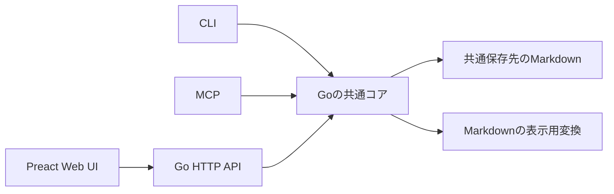

# fragmentのプロダクトとアーキテクチャの初期設計

fragmentは、共通のドキュメントフォルダに置いたMarkdownをCLI、MCP、Web UIから読み書きするローカルアプリケーションとする。プロジェクトの中にflowとstockを持ち、Web UIではMarkdownを整形して表示する。ドキュメントの内容や構成は利用者とAIが自由に決める。

## 要件

- ユーザーのドキュメントフォルダ配下に、プロジェクトごとのデータを保存する。
- 各プロジェクトには `flow` と `stock` の二種類のドキュメントがある。
- 本文、見出し、用途、文書の種類、粒度を固定しない。
- AIと対話しながら、指示した内容をドキュメントとして保存、更新できる。
- ghqのリポジトリやブランチが変わっても、共通の保存先を利用する。
- CLI、MCP、Web UIはGoの共通コアを使って同じデータを操作する。
- GoとPreactのWeb UIで、保存されたMarkdownを整形して閲覧できる。

以下のファイル配置とインターフェースは、この要件を実現するための初期設計案とする。

## flowとstock

flowにはチャットやその場のメモなどを置く。stockには、対話の中で「この内容を残して」「この文書を更新して」と指示した内容を保存する。

何をstockとして残すかは、利用者がその都度決める。一つの会話から文書を作っても、複数の会話をまとめてもよい。既存のstockを更新することもできる。flowからstockへの自動変換は行わない。

アプリケーションが区別するのはflowとstockの保存場所とする。要件、仕様、意思決定などの分類や、下書き、確定などの状態を必須にしない。Markdown本文のテンプレートやfront matterも要求しない。

たとえば、次のように利用する。

1. AIと対話し、必要に応じてチャットやメモをflowへ保存する。
2. 「ここまでの話を概要として残して」と指示し、AIがstockにMarkdownを作成する。
3. 「この説明を追加して」と指示し、同じstockを更新する。
4. Web UIで保存されたMarkdownを読む。

このとき、概要以外の文書が必須になることはない。flowとstockはどちらも通常のMarkdownとして作成、編集できる。

## 共通の保存先

保存先はアプリケーションの共通設定で指定する。次のパスはユーザーのドキュメントフォルダ配下に置く場合の例であり、実際のフォルダ名に合わせて設定する。

```text
~/ドキュメント/fragment/
├── プロジェクトA/
│   ├── flow/
│   │   ├── 会話.md
│   │   └── メモ.md
│   └── stock/
│       ├── 概要.md
│       └── 任意のフォルダ/
│           └── 任意の文書.md
└── プロジェクトB/
    ├── flow/
    └── stock/
```

プロジェクト名、各文書の名前、flowとstock内のフォルダ構成は自由にする。Markdownファイル自体を正本とし、専用データベースや独自のメタデータ入力を閲覧、編集の前提にしない。

保存先はカレントディレクトリやGitブランチから推測しない。どのghqリポジトリで起動しても、同じ共通設定を読む。CLI、MCP、Webサーバーに渡す保存先をそろえ、同じプロジェクト名と相対パスで同じ文書を参照する。

```text
共通設定の保存先
    ↑
    ├── ghqのリポジトリAで使うCLI
    ├── ghqのリポジトリBで使うCLI
    ├── 別ブランチやworktreeで使うCLI
    ├── MCP
    └── Web UIのGoサーバー
```

ブランチを切り替えてもドキュメントの実体は切り替わらない。アプリケーションのソースコードとドキュメントの保存先は別の場所に置く。設定を明示的に変更した場合は、その保存先を利用する。

## Goの共通コア



共通コアは、プロジェクト一覧と作成、flowとstock内の文書一覧、文書の取得、作成、更新を提供する。入口に依存しない入力と結果を定義し、HTTP、CLI、MCPの型や処理から分離する。

文書はプロジェクト名、`flow` または `stock`、その中の相対パスで識別する。各入口は入力を共通コアへ渡し、結果とエラーをそれぞれの形式で返す。MCPとCLIはWebサーバーの起動を必須にせず、同じGoパッケージを直接利用する。

コード配置の案は次のとおり。

```text
cmd/fragment/          # CLI、serve、mcpの起動
internal/app/         # 共通の文書操作
internal/storage/     # 保存先の解決、ファイル読み書き、排他制御
internal/render/      # Markdownの表示用変換
internal/adapters/
    cli/
    http/
    mcp/
web/                  # Preact
```

AIは外部のクライアントからMCPまたはCLIで文書を操作する。fragment自体が会話を自動取得する仕組みは初期版に含めない。flowに保存したい会話は、AIクライアントや利用者が文書操作で書き込む。

## Web UI

Web UIはプロジェクト一覧、flowとstockのファイル一覧、Markdownの整形表示、本文の編集と保存を提供する。ファイルとフォルダの構成をそのまま表示し、必須のダッシュボードや独自の分類を設けない。

保存されたMarkdownはGo側で表示用HTMLへ変換する。ここでいうMarkdownのビルドは、保存された本文を閲覧用に整形する処理とする。表示用HTMLは派生データであり、編集時には元のMarkdownを取得する。

Web UIから保存したら表示を再取得する。CLIやMCPからの変更も、Web UIで再取得すれば同じ内容が見える。初期版で更新ボタンを用意し、自動反映を加える場合は定期的な再取得から始める。

Preactの画面資材はビルドしてGoの実行ファイルに埋め込む構成を想定する。ドキュメントごとの静的サイト出力は初期版の要件に含めない。

## CLIとMCP

次の名前はインターフェース案であり、まだ実行できるコマンドではない。

| 共通操作 | CLI案 | MCPツール案 |
| --- | --- | --- |
| プロジェクト一覧 | `project list` | `list_projects` |
| プロジェクト作成 | `project create` | `create_project` |
| 文書一覧 | `doc list` | `list_documents` |
| Markdown取得 | `doc get` | `get_document` |
| Markdown作成 | `doc create` | `create_document` |
| Markdown更新 | `doc update` | `update_document` |

文書操作にはプロジェクト、flowかstockか、相対パスを渡す。作成と更新にはMarkdown本文も渡す。CLIは機械処理向けのJSON出力を提供し、MCPはstdio接続から始める。

AIがstockを作成、更新するタイミングは利用者の指示に従う。何を保存すべきかをアプリケーションが判定する機能は持たせない。

## 共通データの書き込み

どの入口からも同じファイルを操作するため、更新時の競合検出とプロセス間の排他制御をストレージ側に置く。

取得時にはMarkdownファイルの内容ハッシュをリビジョンとして返す。既存文書の更新では取得時のリビジョンを渡し、プロジェクト単位のプロセス間ロック内で一致を確認して保存する。不一致なら上書きせず、再取得が必要な競合エラーを返す。作成時にも同じロック内で既存ファイルを確認する。

本文の書き込みは同じディレクトリの一時ファイルから置き換え、一つの文書単位で完了させる。複数文書の一括変更は初期版では保証しない。これらの処理はMarkdown本文に独自の必須項目を追加せずに実現する。

ファイル操作は設定した保存先内に限定し、相対パスがルート外へ抜ける操作や配下のシンボリックリンクを拒否する。Webサーバーはloopbackにバインドし、書き込みAPIにローカルセッションの認証とOrigin検証を設ける。Markdownの生HTMLは初期版では無効にし、表示用HTMLとリンクのURLスキームを検査する。

外部エディターからも通常のMarkdownとして読める。外部エディターはアプリケーションのロックに従わないため、同時書き込みの安全性はアプリケーションの入口間で扱う範囲とする。

## 初期実装と確認

| 順序 | 実装範囲 | 確認する振る舞い |
| --- | --- | --- |
| 1 | 共通設定、ファイル操作、CLI | 異なるリポジトリやブランチから起動しても同じMarkdownを取得、更新できる |
| 2 | MCP | CLIで作成した文書をMCPで更新し、同じファイルへ反映できる |
| 3 | HTTPとPreact | flowとstockの文書を整形して読める。CLIやMCPの変更を再取得で確認できる |

入口をまたぐ読み書き、同じリビジョンを使った同時更新、既存ファイルへの作成、不正なパス、保存失敗の結果を確認する。本文に見出しやfront matterがなくても保存、閲覧できることも確認する。

保存先の共通設定を置く場所、対象OSとファイルロックの実装、Webのローカルセッション認証は実装時に具体化する。初期版はローカルディスクを前提とする。

自動分類、自動要約、文書の必須テンプレート、アプリケーション内チャット、Gitブランチごとの文書管理、複数端末同期は初期版に含めない。
